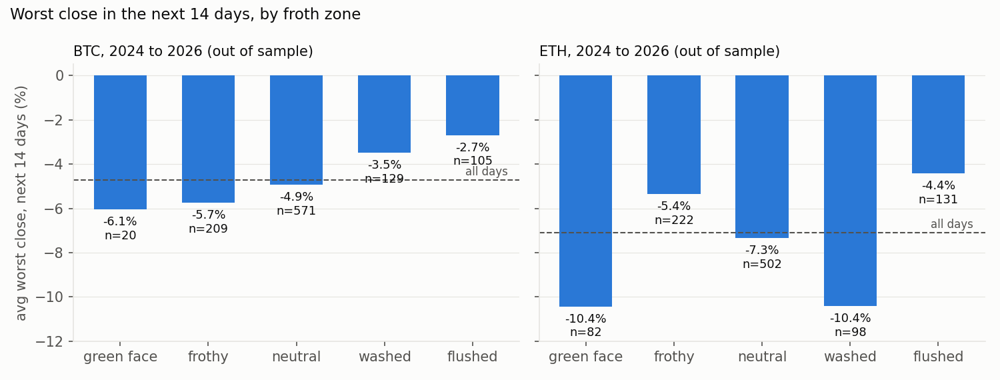
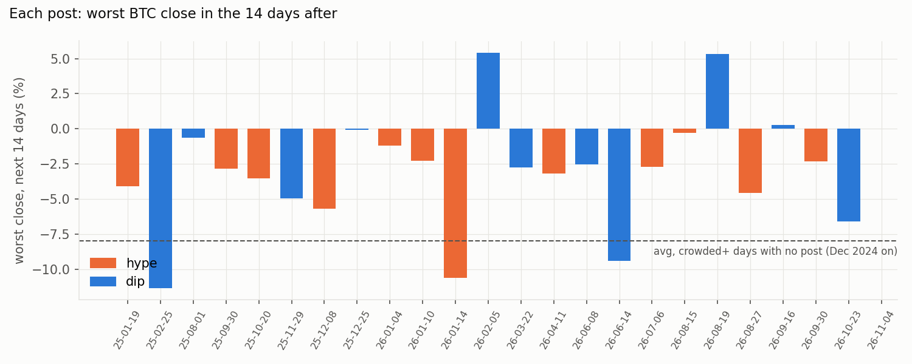
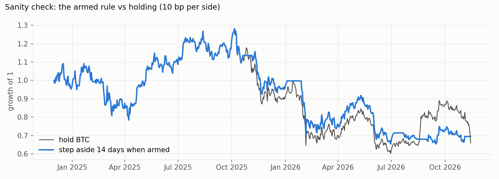
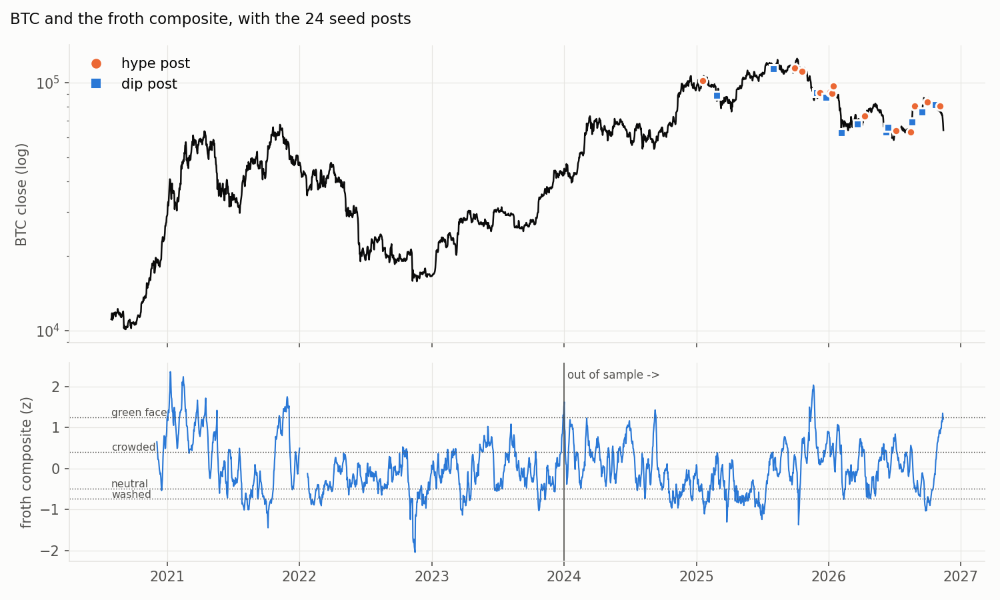

# Green Face Tracker: backtest

(Written when the project was called the Green Face Index; renamed 2026-11-16. The crowding composite tested here is the backdrop gauge on the page.)

Run 2026-11-15. **The zone called "frothy" in this write-up was renamed "crowded" on 2026-11-15**; `summary.json` and the published page use the new name. Numbers are unchanged. Days are calendar days; the one day missing from gt_regime.json (2026-08-24) is filled with the Binance perp close for this research only. Code in this folder: `pull.py` (downloads to `$GREENFACE_RAW`), `data.py`, `backtest.py` (writes `results.json` and `summary.json`), `report.py`, `charts.py`. `summary.json` is what the publisher copies into `docs/greenface.json`'s method block.

## Verdict

**No edge strong enough to call it a top signal. Ship it as a sentiment gauge.**

- The froth composite sorts BTC's 14-day drawdowns in the right order, out of sample. Green face −6.1%, frothy −5.7%, neutral −4.9%, washed −3.5%, flushed −2.7%. Odds of a 10% drop: 30% / 20% / 15% / 7% / 2%.
- The pre-registered test (frothy+ minus neutral, 14-day worst close, out of sample) is **−0.8 points, p = 0.26**. That is not significant. By period the sign is right in 2020–21, 2023–24 and 2025–26; 2022 had only 10 frothy days.
- **ETH: nothing.** Out of sample, frothy+ days were followed by *shallower* drawdowns than neutral days (+0.6 points).
- **The CZ flag adds nothing.** Hype posts made in frothy+ zones were followed by better 14-day outcomes than frothy+ days with no post (−4.5% vs −8.0%, p 0.77), and so were posts in general. The placebo agrees.
- The composite beats both simple alternatives, which point the wrong way on BTC. So the composite ships rather than a simpler gauge, but as a gauge.
- The sanity-check rule (step aside 14 days when armed) beat holding over Dec 2024–Nov 2026: −30.6% vs −34.1%, max drawdown −49% vs −53%. That is 9 switches on 13 posts. Too few events to mean anything.

## Data

| Input | Source (all `data.binance.vision`, USD-M perps) | Columns used | History |
|---|---|---|---|
| Funding | `futures/um/monthly/fundingRate/{SYM}/` | `calc_time`, `last_funding_rate` | BTC, ETH from 2020-01 |
| Funding, month to date | `futures/um/daily/premiumIndexKlines/{SYM}/1h/`, rebuilt as avg premium + clamp(0.01% − premium, ±0.05%) | `open_time`, `close` | 14 days rebuilt (Nov 1–14) |
| Open interest | `futures/um/daily/metrics/{SYM}/` (5-min rows) | `sum_open_interest` (base units), last nonzero row of the day | BTC from 2020-09-01, ETH from 2021-12-01 |
| All-account long/short | same files | `count_long_short_ratio` | same |
| Top-trader position long/short | same files | `sum_toptrader_long_short_ratio` | same, **blank for ~315 days in 2022** |
| BTC daily close | `btc-gt-data/docs/gt_regime.json`, `price` field | | matches the handoff's check values to the dollar |
| ETH daily close, hourly bars | `futures/um/monthly/klines/{SYM}/1d` and `/1h`, plus daily files for the current month | | |

Reachability, checked from a real GitHub runner on a throwaway branch (now deleted): `data.binance.vision` returns 200 for every path above. `fapi.binance.com` returns **451** (blocked from US IPs), as expected. OKX returns 200 and was not needed.

The rebuilt funding correlates 0.92 with the actual 8-hour rates (mean error −0.02 bp, mean absolute error 0.3 bp). It is used only for days the monthly file hasn't covered yet.

## Method (fixed before looking at outcomes)

- **Inputs**, one value per UTC day:
  - funding, 7-day average of daily summed funding
  - OI 30-day log change
  - all-account long/short, 7-day average
  - retail vs top-trader gap, 7-day average of log(account ratio) − log(top-trader position ratio)
- Each input is z-scored against its trailing 365 days (minimum 90). The composite is their mean and needs at least 3 of the 4 inputs.
- **Primary metric:** worst close over days t+1 to t+14, divided by the close on day t, minus 1.
- **In sample** runs from the composite's first day (2020-12-03) through 2023; **out of sample** is 2024-01-01 to 2026-11-14.
- **Zone cut-offs:** composite quantiles in 2020–2023 at the normal-curve positions of the handoff's suggested cut-offs (1.5 / 0.7 / −0.8 / −1.3 → 93.3% / 75.8% / 21.2% / 9.7%). No returns were used to set them. BTC: **1.24 / 0.40 / −0.49 / −0.75**. The handoff's fixed z cut-offs barely fire, because the mean of 4 z-scores has a standard deviation of 0.63, not 1: 1.5 or higher on only 1.8% of days.
- **Significance:**
  - circular block bootstrap with 30-day blocks (one-sided p, "hot zones worse")
  - Welch t-test on non-overlapping windows (every 14th day; median p across the 14 offsets)

## A. Froth index

### A1–A2. By zone, BTC

**Out of sample, 2024 to 2026**

| zone | days | 1d | 3d | 7d | 14d | 30d | 14d worst close | odds of −10% in 14d |
|---|---|---|---|---|---|---|---|---|
| green face | 20 | −0.6% | −0.8% | −1.3% | +0.1% | −2.0% | −6.1% | 30% |
| frothy | 209 | +0.2% | +0.3% | +0.5% | +0.3% | +0.5% | −5.7% | 20% |
| neutral | 572 | +0.0% | +0.2% | +0.4% | +0.6% | +2.9% | −4.9% | 15% |
| washed | 129 | +0.1% | +0.2% | +1.2% | +2.7% | +3.3% | −3.5% | 7% |
| flushed | 105 | +0.2% | +0.7% | +1.4% | +3.5% | +6.7% | −2.7% | 2% |
| all | 1035 | +0.1% | +0.2% | +0.6% | +1.1% | +2.7% | −4.7% | 14% |

**In sample, Dec 2020 to 2023**

| zone | days | 7d | 14d | 30d | 14d worst close | odds of −10% |
|---|---|---|---|---|---|---|
| green face | 74 | −0.4% | −1.5% | +5.7% | −10.5% | 57% |
| frothy | 193 | +2.2% | +5.2% | +3.4% | −6.7% | 29% |
| neutral | 602 | +0.9% | +1.3% | +3.2% | −5.8% | 19% |
| washed | 127 | −0.1% | +1.9% | +4.4% | −5.5% | 20% |
| flushed | 107 | +2.7% | +4.3% | +7.4% | −4.1% | 17% |

**Frothy+ minus neutral, 14-day worst close**

| | difference | 90% CI | block p | non-overlapping p |
|---|---|---|---|---|
| in sample | −1.9 pts | −4.8 to +0.8 | 0.13 | 0.21 |
| **out of sample (primary)** | **−0.8 pts** | **−3.0 to +1.3** | **0.26** | **0.35** |
| out of sample, green face only | −1.1 pts | −5.0 to +5.6 | 0.40 | 0.44 |

Forward *returns* do not separate. Frothy+ days are followed by about flat 14-day returns, and neutral days by +0.6%.

### A3. By period (in-sample cut-offs)

| period | frothy+ days | neutral days | frothy+ minus neutral | block p |
|---|---|---|---|---|
| 2020–21 | 189 | 132 | −1.4 pts | 0.22 |
| 2022 | 10 | 231 | +5.5 pts | 0.97 |
| 2023–24 | 163 | 459 | −1.6 pts | 0.06 |
| 2025–26 | 134 | 352 | −1.0 pts | 0.30 |

The sign is right in 3 of 4 periods. 2022 barely had any froth, so it doesn't count either way.

### A4. Each input alone and dropped (out of sample, frothy+ minus neutral, 14-day worst close)

| | alone | p | composite without it | p |
|---|---|---|---|---|
| funding | **+1.5 pts (wrong way)** | 0.91 | −0.7 pts | 0.30 |
| OI 30-day change | −0.8 pts | 0.19 | −1.3 pts | 0.18 |
| all-account long/short | −0.5 pts | 0.35 | −1.1 pts | 0.18 |
| retail vs top-trader gap | −0.8 pts | 0.29 | −0.9 pts | 0.23 |

No single input carries the result. Funding alone points the wrong way in both samples, and dropping OI does a little better out of sample. **Neither was acted on.** Changing the input set after seeing out-of-sample results is the tuning the rules exclude.

### A5. Cut-offs moved ±0.25

| | frothy+ minus neutral | block p |
|---|---|---|
| +0.25 | −1.6 pts | 0.14 |
| as set | −0.8 pts | 0.26 |
| −0.25 | −1.0 pts | 0.18 |

The shifted cut-offs don't flip the sign and don't become significant.

### A6. Against simpler gauges (same quantile zones)

| gauge | out of sample, frothy+ minus neutral | block p |
|---|---|---|
| composite | −0.8 pts | 0.26 |
| funding alone | +1.5 pts | 0.91 |
| price stretch alone (handoff's setup score) | +0.9 pts | 0.91 |

The composite beats both, so the composite ships.

### A7. Significance

All of the above use a block bootstrap and non-overlapping windows. Nothing out of sample clears p < 0.10.

**Exploratory, not pre-registered:** the low end looks more reliable than the top. Out of sample, washed+flushed minus neutral is **+1.8 points** (shallower drawdowns): one-sided block-bootstrap p = 0.008, non-overlapping p = 0.05. In sample the same comparison is +1.0 points, p = 0.22. The rank correlation between composite and 14-day worst close is −0.11 out of sample and −0.12 in sample. Treat this as a hypothesis: it was found after looking.

### A8. ETH (ETH metrics only start 2021-12, so the in-sample window is Mar 2022–2023)

Cut-offs 0.95 / 0.36 / −0.53 / −0.76.

| zone, out of sample | days | 7d | 30d | 14d worst close | odds of −10% |
|---|---|---|---|---|---|
| green face | 82 | −0.2% | −5.8% | −10.4% | 55% |
| frothy | 222 | +1.1% | +3.0% | −5.4% | 18% |
| neutral | 502 | −0.4% | +1.5% | −7.3% | 28% |
| washed | 98 | −2.2% | −3.3% | −10.4% | 50% |
| flushed | 131 | +4.8% | +10.9% | −4.4% | 18% |

- Frothy+ minus neutral: in sample **+2.7 pts** (wrong way), out of sample **+0.6 pts** (p 0.67).
- Green face only, out of sample: −3.1 pts, p 0.13.

There is no monotone pattern. The index does not carry over to ETH.

## B. CZ flag (sample: the 24 seed posts, 13 hype and 11 dip; no X API key was set)

The zone for each post is the reading at the prior day's close, which is what was visible when the post went out. Outcomes are measured from the post day's close, as in the handoff.

### B1. Posts in frothy+ zones vs frothy+ days with no post

The no-post pool is frothy+ days Dec 2024–Nov 2026 that were more than 3 days from any post: 84 days. 10,000 same-size draws.

| set | posts in frothy+ | 14-day worst close, posts | no-post pool | p (posts worse) | 7d, posts | 7d, pool |
|---|---|---|---|---|---|---|
| hype | 5 (4 with 14 days of data) | −4.5% | −8.0% | 0.77 | −2.0% | −2.2% |
| hype, one per 21 days | 3 (2 with 14 days of data) | −1.9% | −8.0% | 0.77 | −1.7% | −2.2% |
| dip | 5 | +0.6% | −8.0% | 1.00 | +4.9% | −2.2% |
| all | 10 (9 with 14 days of data) | −1.6% | −8.0% | 0.99 | +1.9% | −2.2% |

Posts made into froth were followed by *milder* drawdowns than froth days without a post.

### B2. Hourly event study (perp 1-hour bars)

Only 2 posts have exact timestamps, taken from the x.com status IDs. The rest are dated to the day, so I used two anchors: noon UTC and day end (00:00 the next day). The day-end anchor is the conservative one, since by then the post is certainly out.

| set | n | +4h | +24h | +72h | ±72h high came after the anchor |
|---|---|---|---|---|---|
| hype, exact timestamp | 2 | +0.4% | −2.8% | −3.3% | 1 of 2 |
| hype, noon | 13 | +0.2% | −0.1% | +0.2% | 12 of 13 |
| hype, day end | 13 | −0.2% | −0.3% | +0.8% | 11 of 13 |
| dip, noon | 11 | +0.1% | +0.8% | +1.5% | 4 of 11 |
| dip, day end | 11 | +0.4% | +1.3% | +2.8% | 5 of 11 |
| every 6th hour, baseline | | +0.03% | +0.14% | +0.41% | 49% |

The noon and day-end rows use the exact timestamp for the 2 posts that have one; the placebo below anchors all 13 at noon or day end, which is why it shows 13 of 13 where the table shows 12.

**Placebo for the "high came after" count:** each post's anchor is replaced by the same anchor on a random day with the same zone and the same sign of the prior 72-hour return, 10,000 times.

| | observed | placebo mean | p |
|---|---|---|---|
| hype, noon | 13 of 13 | 7.8 | < 0.001 |
| hype, day end | 10 of 13 | 7.5 | 0.11 |
| dip, noon | 4 of 11 | 5.3 | 0.88 (≥) |
| dip, day end | 5 of 11 | 4.7 | 0.55 |

So the post was usually not the local high: price made a higher high within the next 3 days. Most of that strength is gone at the day-end anchor, which means it came from moves within the post day itself. Coverage-based post selection (news picks posts made on big days) explains a lot of it. With exact timestamps for only 2 posts, this can't be settled.

### B3. One post per 21 days

See the rows above: hype drops to 9 posts, 3 of them in frothy+. Nothing changes.

### B4. Placebo: post dates shuffled within the same zone, 10,000 times

| set | 14-day worst close, observed | placebo | p (worse) | 7d observed | placebo | p (lower) |
|---|---|---|---|---|---|---|
| hype | −3.6% | −5.2% | 0.81 | +2.2% | −0.2% | 0.92 |
| hype, one per 21 days | −2.8% | −5.0% | 0.86 | +3.1% | −0.1% | 0.95 |
| dip | −2.5% | −5.7% | 0.95 | +2.3% | −0.4% | 0.92 |

Posts were followed by *better* outcomes than random days in the same zone.

### B5. Sample

24 posts. No X API key was set, so the post log was not rebuilt from CZ's full timeline. It leans toward posts that made the news, which pulls toward days near big moves.

## C. Sanity check as a rule

**Armed** means a hype post on day d, and the zone is frothy+ at the close of d, d+1 or d+2. **Step aside** means sell at that close and stay out N days, re-entering after N days once the reading is no longer armed. Costs are 10 bp per side; returns are BTC close to close.

| rule | window | return | hold | max DD | hold max DD | time in market | switches |
|---|---|---|---|---|---|---|---|
| armed, N=7 | Dec 2024–Nov 2026 | −37.6% | −34.1% | −51.9% | −53.1% | 93% | 10 |
| **armed, N=14** | Dec 2024–Nov 2026 | **−30.6%** | −34.1% | **−49.0%** | −53.1% | 88% | 9 |
| armed, N=30 | Dec 2024–Nov 2026 | +15.4% | −34.1% | −28.8% | −53.1% | 80% | 9 |
| green face only, N=7 | 2024–Nov 2026 | +66.7% | +45.2% | −43.2% | −53.1% | 96% | 7 |
| green face only, N=14 | 2024–Nov 2026 | +64.9% | +45.2% | −45.9% | −53.1% | 94% | 7 |
| green face only, N=30 | 2024–Nov 2026 | +72.8% | +45.2% | −44.0% | −53.1% | 89% | 7 |

The rule loses at N=7 and wins at 14 and 30. Every row rests on 7–10 switches. The N=30 win is mostly from sitting out January 2026, and the same rule missed the +22% week after Aug 15, 2026. That is not evidence of an edge.

## What shipped (decided 2026-11-15)

1. Zone cut-offs from 2020–2023 data: 1.24 / 0.40 / −0.49 / −0.75.
2. No "armed" state. The CZ section shows his latest post and the scoreboard only; it is not a warning.
3. High readings (frothy, green face) carry a label for what kind of crowding it is: close above its 21-day EMA = "crowded at highs", below = "crowded longs into a selloff". Label only; the index and cut-offs are unchanged. One line under the reading names the input driving it.
4. Method note: sentiment gauge, not a top signal; zone table, the primary p, ETH showing nothing, the low-end result marked exploratory, and that the current month's funding is rebuilt from the premium index. Every number comes from `summary.json` via `docs/greenface.json`.
5. The step-aside rule (section C) is not published as performance.

